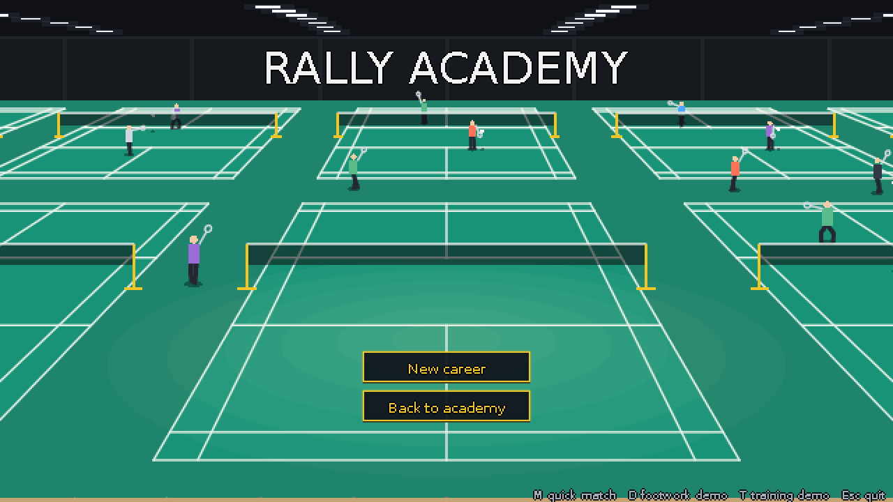
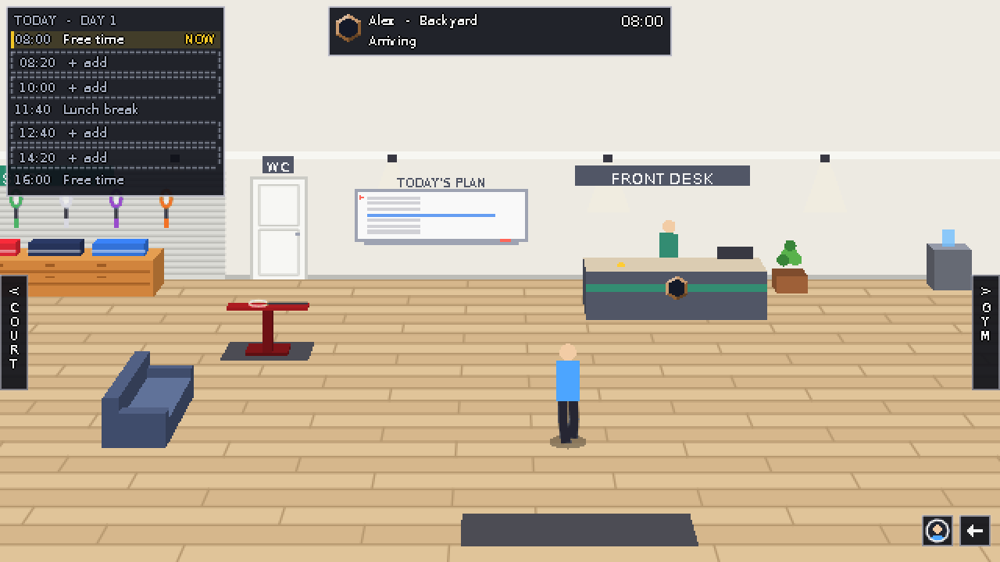
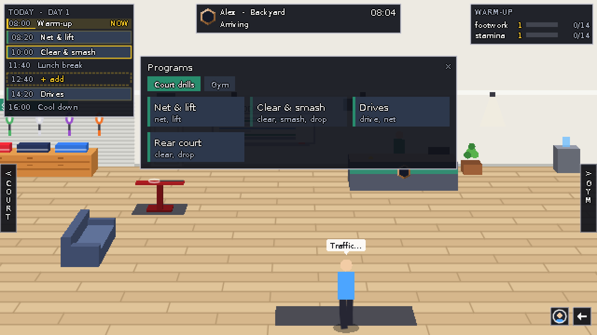
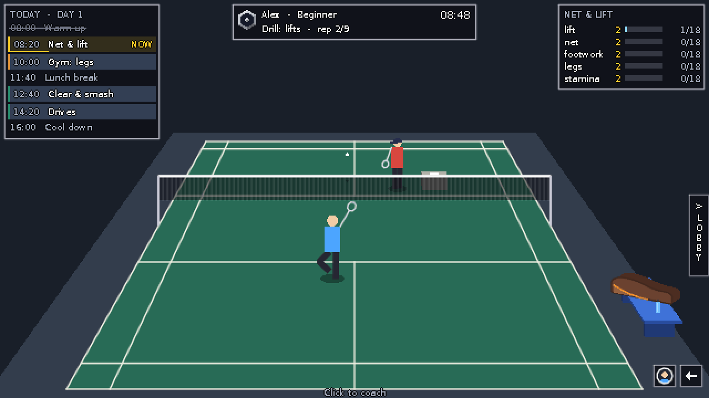
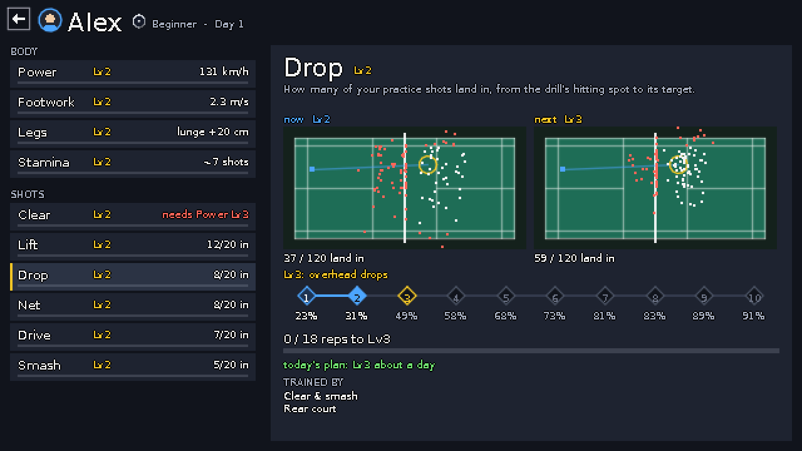
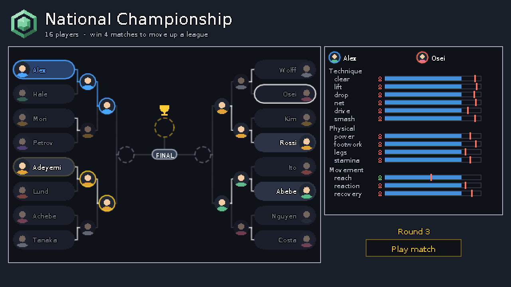
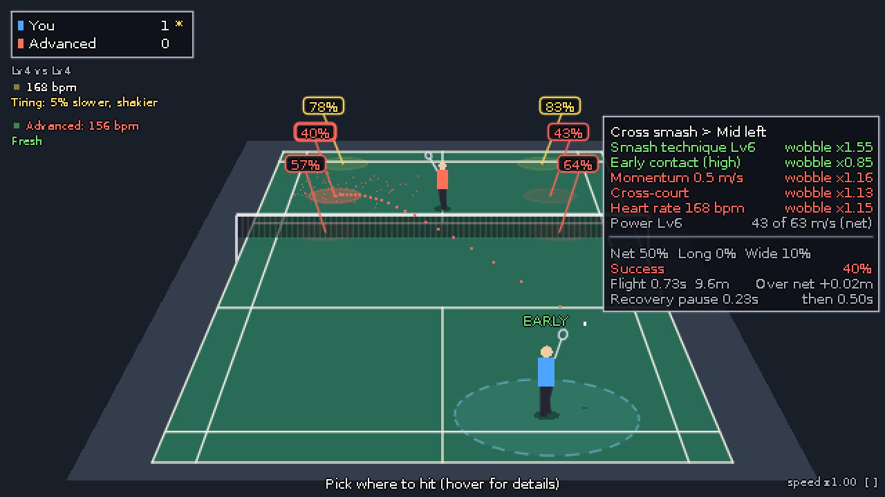
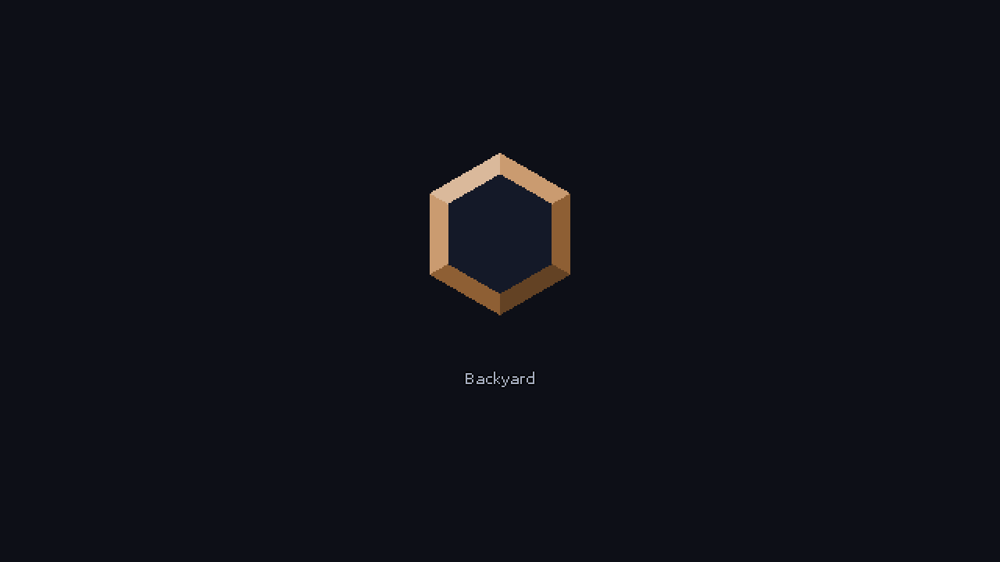

# Rally Academy

A pixel-art badminton game that combines strategic match play with casual idle training, to
follow a badminton athlete's growth from the backyard to world champion. Built with
[LÖVE](https://love2d.org).

*Work in progress.*



**Train.** Plan his day on the lobby whiteboard, then let him get on with it: drills with the
coach on court, sets in the gym, and whatever he feels like in his free time.







**See him grow.** Every stat is something you can picture: smash speed, footwork, lunge reach,
and where his practice shots actually land.



**Compete.** Sign up at the front desk and play the knockout. In a match you call each shot;
the odds come from his technique, footwork and how tired he is. Win the event to move up a
league.








Design doc: https://claude.ai/artifact/EqpHxhQEHdQG2t7RYCGmgh

<details>
<summary><b>Running it and developer notes</b></summary>

### Run

Needs LÖVE 11.5.

```powershell
& "C:\Program Files\LOVE\love.exe" .
```

Use `lovec.exe` instead to see console output and errors.

### Project layout

```
main.lua, conf.lua      LÖVE entry points (thin)
src/core/               Pure game rules: court, shots, athlete, rally, match, ai, training,
                        career, tournament. NO love.* calls.
src/data/               Balance numbers as plain Lua tables (shots, athletes, training, career).
src/config/layout.lua   Screen layout, camera, colors - nudge UI positions here.
src/view/               Drawing + UI (only layer that uses love.graphics).
src/scenes/             Title, hub (the academy), tournament, match, promotion, demos.
src/app.lua             Canvas scaling, scene switching, dev flags.
tools/sim/              Headless AI-vs-AI balance simulation.
tools/bench/            Trajectory/shot-model speed + accuracy benchmark.
assets/                 Fonts and sprites (placeholders for now).
```

The core/view split is deliberate: rules and data can be ported to another engine
without touching drawing code, and the simulation runs without rendering.

### Jump straight in

A fresh career at league N, the athlete page, or a bracket two wins in:

```powershell
& "C:\Program Files\LOVE\lovec.exe" . --career 1
```

```powershell
& "C:\Program Files\LOVE\lovec.exe" . --career 2 --open athlete:drop
```

```powershell
& "C:\Program Files\LOVE\lovec.exe" . --career 5 --open bracket:2
```

### Demos

```powershell
& "C:\Program Files\LOVE\lovec.exe" . --demo training
```

```powershell
& "C:\Program Files\LOVE\lovec.exe" . --demo balance
```

Or press T (training) or D (footwork) on the title screen.

### Dev tools

Unit tests (geometry: what is drawn matches the model numbers):

```powershell
& "C:\Program Files\LOVE\lovec.exe" tests
```

Balance simulation (runs core only, prints win rates):

```powershell
& "C:\Program Files\LOVE\lovec.exe" tools/sim 300
```

Trajectory benchmark (speed and accuracy of each algorithm config vs a high-precision
reference; writes `tools/bench/results.md`):

```powershell
& "C:\Program Files\LOVE\lovec.exe" tools/bench
```

Automated screenshot (saved to `%APPDATA%\LOVE\rally_academy\screenshots\shot.png`):

```powershell
& "C:\Program Files\LOVE\lovec.exe" . --profile 4 --opp 4 --seed 3 --auto 3 --hover 3 --shot 1
```

Animated GIF (saved to `%APPDATA%\LOVE\rally_academy\screenshots\shot.gif`; the README clips
were made this way):

```powershell
& "C:\Program Files\LOVE\lovec.exe" . --profile 5 --opp 5 --seed 3 --auto 99 --gif 0.5 --giflen 8
```

See `src/dev.lua` for all flags.

</details>
