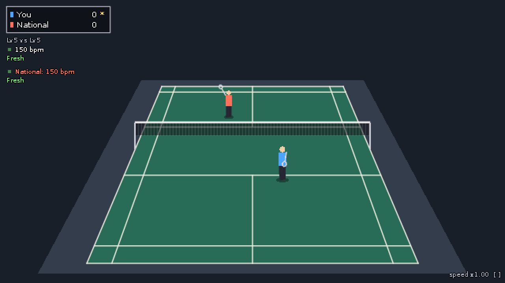
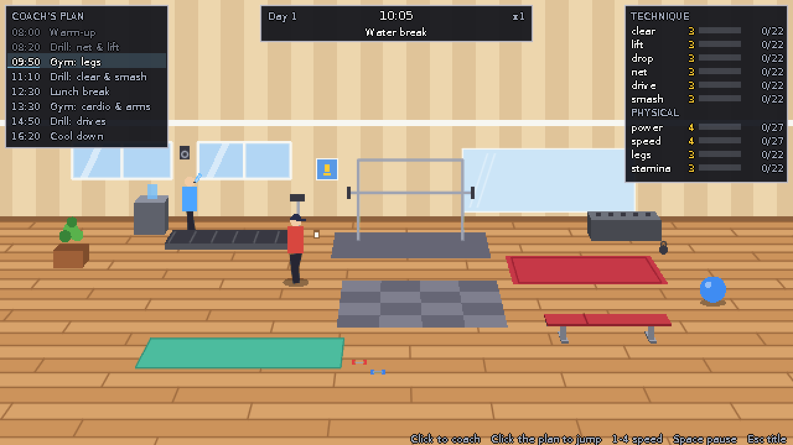

# Rally Academy

A pixel-art badminton game about coaching a player, built with [LÖVE](https://love2d.org).

You don't control the footwork. On court, the game pauses each time your player is about to
hit, and you choose where the shuttle goes. Every target shows its odds, which depend on his
technique, how early he got there, his momentum and his heart rate. Then you pick where he
recovers to. Off court, he follows the training plan you set: drills with a feeder, sets in
the gym, and plenty of water breaks, phone checks and lunchtime naps that run long. You
watch, and click to shout at him when he slacks off. The goal is to take him from the
backyard to world champion.

*Work in progress.*






Design doc: https://claude.ai/artifact/EqpHxhQEHdQG2t7RYCGmgh

<details>
<summary><b>Running it and developer notes</b></summary>

### Run

Needs LÖVE 11.5.

```powershell
& "C:\Program Files\LOVE\love.exe" .
```

Use `lovec.exe` instead to see console output and errors.

### Project layout

```
main.lua, conf.lua      LÖVE entry points (thin)
src/core/               Pure game rules: court, shots, athlete, rally, match, ai, training. NO love.* calls.
src/data/               Balance numbers as plain Lua tables (shots, athletes, training).
src/config/layout.lua   Screen layout, camera, colors - nudge UI positions here.
src/view/               Drawing + UI (only layer that uses love.graphics).
src/scenes/             Title, match and demo scenes: glue between core and view.
src/app.lua             Canvas scaling, scene switching, dev flags.
tools/sim/              Headless AI-vs-AI balance simulation.
tools/bench/            Trajectory/shot-model speed + accuracy benchmark.
assets/                 Fonts and sprites (placeholders for now).
```

The core/view split is deliberate: rules and data can be ported to another engine
without touching drawing code, and the simulation runs without rendering.

### Demos

```powershell
& "C:\Program Files\LOVE\lovec.exe" . --demo training
```

```powershell
& "C:\Program Files\LOVE\lovec.exe" . --demo balance
```

Or press T (training) or D (footwork) on the title screen.

### Dev tools

Unit tests (geometry: what is drawn matches the model numbers):

```powershell
& "C:\Program Files\LOVE\lovec.exe" tests
```

Balance simulation (runs core only, prints win rates):

```powershell
& "C:\Program Files\LOVE\lovec.exe" tools/sim 300
```

Trajectory benchmark (speed and accuracy of each algorithm config vs a high-precision
reference; writes `tools/bench/results.md`):

```powershell
& "C:\Program Files\LOVE\lovec.exe" tools/bench
```

Automated screenshot (saved to `%APPDATA%\LOVE\rally_academy\screenshots\shot.png`):

```powershell
& "C:\Program Files\LOVE\lovec.exe" . --profile 4 --opp 4 --seed 3 --auto 3 --hover 3 --shot 1
```

Animated GIF (saved to `%APPDATA%\LOVE\rally_academy\screenshots\shot.gif`; the README clips
were made this way):

```powershell
& "C:\Program Files\LOVE\lovec.exe" . --profile 5 --opp 5 --seed 3 --auto 99 --gif 0.5 --giflen 8
```

See `src/dev.lua` for all flags.

</details>
